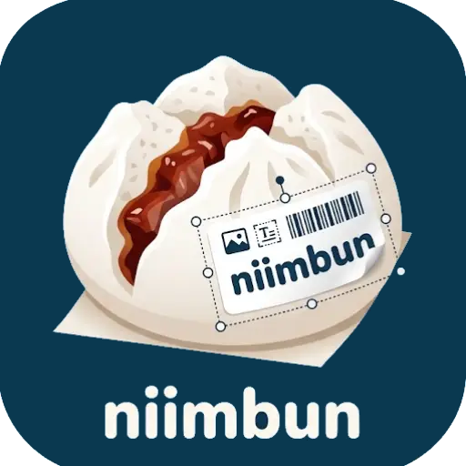

<p align="center">
  
</p>

# niimbun-label-editor

A browser-based label editor for NIIMBOT thermal printers.

Design labels on an arbitrary backing sheet, bind them to CSV data for
variable per-row output, preview exactly what will be printed, and send the
job straight to the printer over Bluetooth or serial.

## Features

- **Flexible geometry** — a label is a backing rectangle plus a set of printable
  regions, so rectangles, rounded corners and F-shaped cable tags all work.
- **Objects** — text, images, shapes, QR and 2D barcodes, with layers and groups.
- **Variable data** — attach a CSV and reference its columns from text objects;
  preview any row before printing the whole batch.
- **Templates** — optional JavaScript templates evaluate against a row context in
  a Web Worker, behind an explicit per-document trust prompt.
- **Colour pipeline** — a scene is rasterised and then colour-converted to
  printer planes, with threshold, Floyd–Steinberg, Stucki, Atkinson and
  Ostromoukhov dithering plus head-locked screentone.
- **Direct printing** — NIIMBOT printers over Bluetooth or serial, with batch
  jobs, two-phase send/print progress, and offset and DPI controls.

## Development

Requires [Bun](https://bun.sh).

```sh
bun install
bun run dev        # dev server
bun run test:run   # Vitest suite
bun run build      # typecheck + production build
```

`bun.lock` is the tracked lockfile.

## License

MIT — see [LICENSE](LICENSE).
