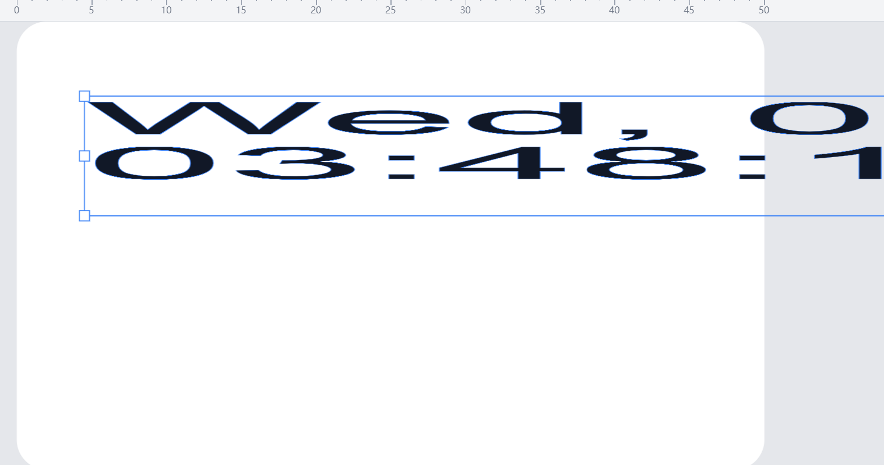
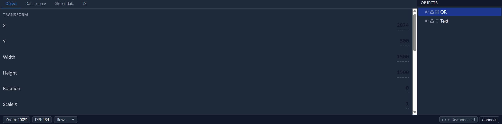
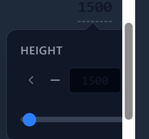

# Known issues2

- Date: 2026-10-06
- Status: Started; after `2026-10-06_ui-sweep`; findings **verified 2026-10-09** (9 parallel `explore` agents, HEAD after `214aef2`/`5c756e8`). Report: [`agent/2026-10-09_known-issues-verification/verification-report.md`](../2026-10-09_known-issues-verification/verification-report.md).
- Verification result: **24 of 25 findings accurate.** Corrections applied inline below and tagged **[verified 2026-10-09]**. Headline: the "Duplicated printer icon" finding was wrong about the editor bar; the "duplicate/bulk-select drag" issue text is wrong (no selection-swap code exists); the trust gap is broader than the prompt; resize citations drifted.

## Dragging text node should change the text box size and not aspect ratio
**Status: ✅ fixed (2026-10-09)** — `handleTransformEnd` resets the stale live Konva node scale at commit (and the `pointercancel` path restores it); `strokeWidth` no longer scales on resize. Regression tests in `PreviewStage.interaction.test.tsx` + `geometry.test.ts`.

Expected: Dragging the resize control on a text node should change the text box size, and not the aspect ratio of the inner text. Resize should not make the inner text smaller or larger, it should only change the layout/wrap of the text. 

Actual: Dragging the resize control on a text node changes the aspect ratio of the inner text, making it wider or narrower. Similar to a "wide putin" effect. The text box size changes alongside.

Inner contents that must not have their aspect ratio changed: text, qr code

Also, dragging the control handles for shapes should not change the line width of the lines. it should resize the points' locations, not the line width, because thats belonging to the line width setting, not the shape itself.

### Research findings

- `src/components/editor/PreviewStage.tsx:287-294` enables aspect locking only for a single node whose type is ellipse, image, or QR. Text is intentionally free-resize by default.
- `src/components/editor/PreviewStage.tsx:596-662` reads Konva's live `scaleX`/`scaleY`, computes the target box, and commits through `transformEndPatch`; the Transformer scale is not left on the document.
- `src/editor/transformGesture.ts:101-149` passes the resize policy to `resizeNodeGeometry` and folds the result into node geometry. For free text resize, the box changes while `fontSize` is left unchanged (`src/core/doc/geometry.ts:175-189`), so the current commit path does not intentionally create a wide/narrow text glyph. The reported text symptom likely came from the older raw-transform path or from an aspect-locked/modifier gesture; add a regression test around the actual UI gesture if it is still reproducible.
- QR is still vulnerable on side handles: `src/components/editor/PreviewStage.tsx:766-767` sets `keepRatio` globally, but Konva applies it only to corner anchors. The commit logic also treats side anchors as free resize (`src/editor/transformGesture.ts:176-222`), so a side drag can make the QR box and raster non-uniform. Fix by making QR resize policy preserve the ratio for every resize anchor, or by constraining the live side-anchor target to one uniform factor before commit. Keep text free-resize.
- Shape line width has a confirmed root cause: `src/core/doc/geometry.ts:154-164` scales line/polygon points and then calls `scaleStroke`, while `src/core/doc/geometry.ts:200-207` scales `strokeWidth` from the resize factors. Remove `scaleStroke` from the line/polygon branch. Resize should scale only `points`. So does rectangles and ellipses.
- Focused validation: `npm run test:run -- src/core/doc/geometry.test.ts src/editor/transformGesture.test.ts src/editor/transformGesture.konva.test.ts` passed, 3 files and 47 tests. Existing tests confirm free text preserves `fontSize` (`src/core/doc/geometry.test.ts:103-108`) but do not cover QR side-handle behavior or line/polygon stroke-width invariance.

### Root cause (round 3)

- **Text "wide putin" = the same stale live Transformer scale as the rectangle issue, not the document geometry.** `resizeNodeGeometry` is innocent: for free resize (`preserveAspect: false`) the text branch changes only the box `size` and leaves `fontSize` untouched (`src/core/doc/geometry.ts:176-189`). During the drag Konva scales the whole `Konva.Text` node in place (`Transformer._fitNodesInto`, `Transformer.js:814-831`), and `handleTransformEnd` never resets it (`PreviewStage.tsx:798-871`). Because the doc scale resolves back to `1` (unchanged prop), react-konva skips the write (`makeUpdates.js:127-132`, strict mode off) and the glyphs stay stretched after release. Fixing the rectangle root cause (reset the node scale at commit) fixes the text glyph aspect distortion too.
- **QR shares the text mechanism, plus a genuine policy gap.** The prepared raster is `contain` (`konvaFactory.ts:149-153`) so the raster itself is not stretched, but the node's leftover live scale stretches the whole asset `KonvaGroup` (`ResolvedShape.tsx:188`) exactly like text. Separately, `commitPreservesAspect` returns `false` for any non-corner anchor (`transformGesture.ts:213-222`), and Konva applies `keepRatio` **only to corner anchors** — so a **side-handle** drag on an aspect-default QR commits a non-uniform `size` even after the stale-scale fix. To meet "inner contents that must not change aspect ratio: text, qr code", QR/ellipse/image must commit uniformly for **every** resize anchor, not just corners.
- **Shape line width is scaled on resize by the port, and the reference never does this.** `resizeNodeGeometry` folds `scaleStroke` into the line/polygon (points) branch (`geometry.ts:163`) and into rect/ellipse (`geometry.ts:173`) and image/qr/barcode (`geometry.ts:196`), changing `strokeWidth` by `uniformFactor(sx, sy)`. `template-webui/src/components/canvas/ShapeRenderer.tsx:141-202` never writes `strokeWidth` on `transformend`, so the reference keeps line width constant — the behaviour this issue asks for. Remove `scaleStroke` from the line/polygon branch (resize should scale only `points`) and, per the issue, from the rect/ellipse branch as well.
- **Fix summary:** (1) reset the live node scale at commit (rectangle fix, also cures text/QR distortion); (2) make the aspect policy uniform for all anchors on qr/image/ellipse; (3) drop `scaleStroke` from resize so handles change geometry, not line width.
- **Focused validation:** add a mounted-stage regression that fires a real `transformend` and asserts the text glyph box changes while `node.scaleX()/scaleY()` return to `1`; a QR side-handle case asserting a square committed box; and geometry tests asserting `strokeWidth` is invariant across resize for rect/ellipse/line/polygon.

#### QR side-handle — owner-verified, refined root cause (2026-10-09)

Owner reproduced at HEAD: corner drag keeps the aspect ratio (correct); **side-handle drag is still allowed for QR and should not be** — it letterboxes the raster and trips the "*outside the printable area*" (keep-out) warning as a false positive. Full chain:

1. The `<Transformer>` (`PreviewStage.tsx:1091`) has **no `enabledAnchors`** (grep: no `enabledAnchors`/`resizeEnabled`/`boundBoxFunc` anywhere in `src`), so a QR gets all 8 handles. `keepRatio={selectedNodesPreserveAspect}` (`PreviewStage.tsx:1094`; predicate `:385-389` → `preservesAspectByDefault` for qr/image/ellipse, `geometry.ts:50-53`) locks **corners only** — Konva ignores `keepRatio` on side anchors.
2. On a side drag the commit anchor is a side anchor (`PreviewStage.tsx:891`), so `commitPreservesAspect` (`transformGesture.ts:218-219`) returns `isCornerAnchor(anchor) && liveUniform` = **false** for the QR.
3. `preserveAspect=false` → `sizeFactors` returns independent `sx`/`sy` (`geometry.ts:88`) → `resizeNodeGeometry` bakes a **non-uniform `size`** (`geometry.ts:191-196`). The box becomes over-wide.
4. The QR raster is generated **square** (`prepareAssets.ts:219-231`; `qrImage.ts:63` uses one integer scale for both axes); `konvaFactory.ts:198` forces `fit: 'contain'` for qr/barcode. With a square source in an over-wide box, `fitImageAttrs` (`konvaFactory.ts:163-167`) centres and letterboxes it: `drawW = drawH = boxH`, `x = (boxW−boxH)/2`. Same math in the editor (`ResolvedShape.tsx:216-226`).
5. The keep-out predicate is **box-based, not ink-based**: `PreviewStage.tsx:273` → `nodesIntersectNonPrintable` (`regionOverlay.ts:243-255`) samples `nodeLocalPoints` = `rectCorners(0,0,w,h)` from `nodeSize` (`resolve.ts:261-281`) — the committed box, not the fitted raster. The over-wide box's left/right edges fall outside the region union, so it publishes `kind:'keep-out'` → `en.json:415` `"warningKeepOut"` "*{{node}} is outside the printable area.*" (`WarningsTab.tsx:22-23`). False positive.
6. Separately, the print-dialog path `printOrientation.ts:110/141` (`hasInkBeyondPrinthead`) **is** ink-aware — that is the unrelated "*Label exceeds the printhead*" warning, not this one.

**Fix directions (complementary):** (a) primary — restrict anchors to corners for aspect-default nodes via `enabledAnchors` computed from `selectedNodesPreserveAspect` (`PreviewStage.tsx:1091`), so a non-uniform box can never be committed (safer than dropping the `isCornerAnchor` gate, which risks the #13 release-snap); (b) defensive — make keep-out ink-aware by using the `contain`-fitted rect for qr/image/barcode in `nodesIntersectNonPrintable`/`nodeLocalPoints` (also heals pre-existing malformed docs).


## QR "too small" warning mis-measures the module (2× unit error) — root-caused (2026-10-09)

**Status: fix in progress (2026-10-09).** Owner-driven, verified against bwip-js. The warning threshold value (`MIN_MODULE_MM = 0.25`) is **correct**; the way the verdict is computed is **~2× too strict**.

- **Payload ground truth:** `https://example.com` @ EC M = **QR version 2 = 25×25 modules**. Owner measured on a 300 dpi printer: symbol **600 hm (6 mm) = 0.24 mm/module** is the practical minimum; **500 hm (5 mm) = 0.20 mm/module** still scans but is marginal and visibly eats the ECC budget (a white module rendered as a non-square rectangle — height < width). `0.25 mm` sits right between the two, so **do not re-tune the constant**.
- **The unit bug:** bwip-js renders `qrcode` at **2 device px per `scale` unit** at scale 1 (measured: `'hi'` EC-H = 21 modules → 42 px; scale 1/2/3 for the 25-module payload → 50/100/150 px). But `qrImage.ts:68` compares the bwip `scale` (units) against `minModulePx` (device px): `belowMinModule: scale < minModulePx`. At 300 dpi `minModulePx = ceil(0.25·(300/2540)·100) = 3 px`.
- **Consequence:** the warning needs `scale ≥ 3` to clear, i.e. it keeps firing until the symbol reaches ~**12.7 mm** — whereas the physical 0.25 mm floor and the owner's data put the cutoff at ~**6.25 mm**. It over-warns across the whole ~6.3–12.7 mm band (all false positives).

| symbol  | module mm | effective px/module | bwip `scale` | current  | correct |
| ------- | --------- | ------------------- | ------------ | -------- | ------- |
| 5.0 mm  | 0.200     | 2.36                | 1            | warn     | warn    |
| 6.0 mm  | 0.240     | 2.84                | 1            | warn     | warn    |
| 7.0 mm  | 0.280     | 3.32                | 1            | **warn** | ok      |
| 10.0 mm | 0.400     | 4.72                | 2            | **warn** | ok      |
| 12.7 mm | 0.508     | 6.00                | 3            | ok       | ok      |

- **1D barcodes are NOT affected:** `barcodeImage.ts:73` compares `scaleX`, which genuinely is px per narrow module (code128 `scaleX` 1→101 px, 2→202 px). Only the QR branch miscounts.
- **Fix (decided):** make the QR verdict use the **effective module size**: `moduleCount = round(measure.width / 2)` (= base symbol width / 2 px-per-module), then `belowMinModule = Math.min(targetW, targetH) / moduleCount < minModulePx`. `targetPx/moduleCount` is the module pitch after the fit, i.e. the size that actually prints, so this matches both the physical floor and the owner's measurements.
- **Regression test:** for the 25-module payload at `minModulePx = 3`, a 100 px box (effective 4 px) must be `belowMinModule: false` (previously `true`), and a 74 px box (2.96 px) must be `true`.
- **Separate, still-open artifact:** the visible distortion (triangle / non-square modules) is a *resampling* artifact, not the verdict — the integer-module raster is upscaled by `contain` into the box (fractional factor) and then 1-bit-thresholded at print, eroding/notching corners. Tracked below.
- Focused validation: `bun run test -- src/editor/render/assets.test.ts` (+ a new boundary case). The existing `too-small` tests still pass because the new value is ≥ the old one only where `scale` under-counted.

### Triangle / non-square module artifact (resampling) — open

**Symptom (owner, 300 dpi, `https://example.com` EC M):** at 600 hm (6 mm) a "single pixel" (module) prints as a triangle / not-square-ish; at 500 hm (5 mm) still scans but marginal; at 5 mm one white module printed as a rectangle with height < width.

**Cause — two scale steps between the crisp module and the printed dot; the second is the bug:**

1. **Generation picks an integer module pitch that is ≤ the box.** `renderQr` measures `baseW = 2·moduleCount` (bwip renders 2 px/module at scale 1 — verified for v1/v2/v3/v7 across EC L/M/H; `baseW` always even), then `scale = floor(min(boxPx)/baseW)` and returns a canvas of `baseW·scale` px (`qrImage.ts:57-68`). So the raster is **always ≤ the box**. The bitmap is never resampled *inside* the generator — that part of the "never resample" intent holds.
2. **Placement upscales it.** `konvaFactory.ts:198` forces `fit:'contain'` for qr/barcode; `fitImageAttrs` (`konvaFactory.ts:163-167`) computes `scale = min(boxW/srcW, boxH/srcH) = boxPx/rasterPx ≥ 1` and draws at `width = height = boxPx`. The square raster is enlarged by a **fractional** factor (canvas smoothing on by default) → antialiased module edges.
3. **Print thresholds to 1 bit.** QR's quantizer is `threshold`, cutoff 128 (`src/core/render/policy.ts:19`, `src/core/render/quantize.ts:127`). A softened corner whose grey straddles 128 flips to black/white → a square corner becomes a **triangle/notch**. The fractional pitch rounds differently per row/column and per axis, so a module can print as a **rectangle with unequal sides** (owner's "white pixel, height < width" = erosion on one axis).

**The upscale factor is non-monotonic in symbol size** (25-module payload, 300 dpi, `baseW = 50`, `imageScale = 300/2540`):

| symbol  | box px | raster px | upscale   |
| ------- | ------ | --------- | --------- |
| 5.0 mm  | 59     | 50        | 1.18×     |
| 6.0 mm  | 71     | 50        | 1.42×     |
| 7.0 mm  | 83     | 50        | 1.66×     |
| 8.0 mm  | 94     | 50        | 1.88×     |
| 8.47 mm | 100    | 100       | **1.00×** |
| 12.7 mm | 150    | 150       | **1.00×** |

Worst just below a multiple of `baseW`; exactly on a multiple the raster equals the box and there is **no resample** (crisp). This is why some sizes look clean and others show triangles — independent of scannability, which tracks module mm.

**ECC link:** at 5 mm the module is ~2.36 px (0.20 mm, already below the 0.25 mm floor) and the fractional pitch makes the printed grid non-uniform, so decoder sample points drift. Those soft errors consume the Reed–Solomon budget; distortion need not erase a module to spend ECC, and a fully-inverted module counts as a hard error. Enough of them → unreadable. This is the owner's "eating into the ECC budget".

**Constraint (why a resample is unavoidable):** bwip's `qrcode` emits **2 px per module per integer `scale`** (verified: `scaleX:1` → 2 px/module, `2`→4, `3`→6; 1D `code128` is 1×). So for a 25-module code the only producible raster sizes are `2·25·scale = 50 / 100 / 150 px = 4.23 / 8.47 / 12.70 mm` at 300 dpi. Filling an arbitrary box therefore **always** resamples.

**Fix options for the artifact (separate pass; none is the verdict fix):**
- **(A) REJECTED — "never upscale" (draw 1:1 centred).** Withdrawn from an earlier draft: it **shrinks the symbol**. A 7 mm/25-module QR has an 83 px box, but the largest raster that fits is 50 px (4.23 mm), so 1:1 would print it at **~4.2 mm instead of 7 mm**. Wrong physical size — do not use.
- **(B) REJECTED — snap the box to a producible raster size.** At 300 dpi only 4.23 / 8.47 / 12.70 mm are available, so snapping moves the label by up to ±2.1 mm. Too coarse.
- **(C) Draw the module grid directly at the box's device px.** Get `moduleCount` from the symbol and blit each module to `round`-quantized boundaries at the box's exact px. Exact size, crisp, no antialias/threshold triangles; modules come out 3/4 px (uneven but square). Best result, most code.
- **(D) Disable smoothing for the symbol draw.** `Konva.Context` proxies `imageSmoothingEnabled` (`node_modules/konva/lib/Context.js:70`); since it is a context-level property, a per-node fix needs a small custom `sceneFunc` (or a dedicated draw) to set it around the `drawImage`. Keeps the box size — the module boundaries still telescope to the exact `boxPx`, so 7 mm stays 7 mm. Turns the antialiased upscale into crisp nearest-neighbour blocks: each module differs from the ideal pitch by at most **±1 device px (0.085 mm)**, and because a square raster in a square box maps identically on both axes the modules stay **square** (this also removes the height≠width erosion). **Owner-accepted as good enough**; cheapest correct-size fix.
- **(E) Generate higher, downscale once with smoothing.** Render at the next integer `scale` ≥ box (e.g. 100 px) then downscale to the box with a good filter, so there is a single resample instead of floor-then-upscale. May look smoother, but re-introduces greys the threshold can notch — less certain than (C)/(D).
- **Recommended:** (D) as the cheap correct-size fix, or (C) for best quality. Validate through `renderLabelPage`, not just `PreviewStage` (the preview's zoom scale can hide the artifact).

## Unexpected behaviours when resizing a rectangle
**Status: ✅ fixed (2026-10-09)** — follow-up landed: the shape stroke no longer thickens during a live drag (`strokeScaleEnabled={false}` + zoom/node-scale compensation), and an OS-stolen mouse (`window` `blur`/`visibilitychange`) or `pointercancel` now cancels the whole gesture (transform, move, pan) instead of leaving it stuck. Commit-scale fix landed earlier (`214aef2`).

Steps to reproduce:
1. Create a rectangle
2. Resize from right edge: Drag right control handle to the right, release, the edge does not land on where you released it. It could resize along your chosen direction but with more or less magnitude than you intended.
3. The issue is compounded when you resize from the corners. Both edges of the rectangle will not land on where you released them. In each independent direction, the rectangle will resize along your chosen direction but with more or less magnitude than you intended.

Suspecting coordinate system mismatch? Because somehow this issue is more significant on right half of the canvas.

### Research findings

- Browser reproduction remains: a 53 CSS-pixel right-handle drag changed a rectangle from width `1500` to `2123` hm and shifted x from `1203` to `1213` hm. Integer hm rounding cannot produce this: each rounded value contributes less than `0.005 mm`.
- The live page uses a `712 x 247` CSS canvas with a `1246 x 432` backing canvas at `devicePixelRatio = 1.75`. The backing ratio is therefore expected HiDPI rasterization, not proof that document coordinates are multiplied by `1.75`.
- Konva 10 maps pointer coordinates from the content `getBoundingClientRect()` to `content.clientWidth`. On the live page both are `712 x 247`, so the observed resize is not explained by a CSS/backing-size ratio leaking directly through Konva's pointer mapper.
- The Stage passes CSS-sized dimensions to Konva, but the Transformer and all editable nodes live inside a Layer carrying the viewport zoom (`matrixForViewportAttrs(viewportMatrix)`). `handleTransformEnd` then treats the selected node's live `scaleX`/`scaleY` as local document geometry and bakes them through `transformerTargetSize` and `transformEndPatch`. This Layer-transform/Transformer-scale boundary is the strongest remaining suspect, especially because the symptom is position-dependent.
- The pure and Konva-backed suites pass (`npm run test:run -- src/core/doc/geometry.test.ts src/editor/transformGesture.test.ts src/editor/transformGesture.konva.test.ts`: 3 files, 47 tests). They do not exercise a real pointer drag through the mounted, viewport-scaled Stage, so they cannot falsify the remaining UI-level hypothesis.
- Exact failing conversion is not isolated yet. The next discriminating probe must record, for one drag, the release client coordinate, `stage.getPointerPosition()`, the Transformer's absolute edge, the selected node's local scale, and the node's absolute scale. Compare the released edge in Stage CSS pixels with the committed edge after the transient update. Repeat at left and right canvas positions; do not use the browser input tool's raw coordinates as ground truth without measuring the actual client event.
- Follow-up investigation rules out the viewport-scaled Layer as a direct scale leak. Konva's Transformer computes its target box in absolute coordinates, then converts it through the parent transform's inverse before writing node-local `x`, `y`, `scaleX` and `scaleY`; `scaleX()` therefore excludes the Layer's viewport zoom, while `getAbsoluteScale()` includes it. The current `handleTransformEnd` read is using the correct local scale, and the focused suites still pass (`47` tests across `3` files).
- A remaining boundary mismatch is possible because the Transformer includes stroke in its bounds (`ignoreStroke` is unset), while `transformerTargetSize` starts from the node's fill `size`. Selected rectangle rendering also changes the visible stroke width. The next probe should compare the absolute handle edge and committed visible edge against the fill edge and stroke width; a difference near the stroke extent would identify this as the remaining cause. The browser drag must first be confirmed to land on the actual anchor.

### Root cause (round 3) — stale live Transformer scale is never reset

- **Confirmed: this is a "double resize" at the render layer, not a coordinate-system mismatch.** Konva's Transformer mutates the selected node's own `scaleX`/`scaleY` in place during the drag (`Transformer._fitNodesInto`, `node_modules/konva/lib/shapes/Transformer.js:814-831`); `_removeEvents` fires `transformend` without ever resetting them (`Transformer.js:696-718`).
- `handleTransformEnd` (`src/components/editor/PreviewStage.tsx:798-871`) reads the live scales, bakes the magnitude into document `size` via `transformEndPatch`, but collapses the **document** scale to its sign (`src/editor/transformGesture.ts:144-145`) and **never calls `konvaNode.scaleX(1)/scaleY(1)`**. `finalizeGesture` skips its `forceUpdate` while transforming (`PreviewStage.tsx:684`), so nothing else clears it either.
- On the commit re-render, `ResolvedShape` re-emits `scaleX: 1, scaleY: 1` from `matrixToKonvaAttrs(node.localTransform)` (`konvaFactory.ts:40-48`), which is **equal to the pre-gesture prop value**, because the doc scale is `1` before and after (`transformGesture.ts:144-145`). react-konva only writes a non-event prop when `props[key] !== oldProps[key]` (`node_modules/react-konva/lib/makeUpdates.js:127-132`), and its strict mode is **off** (`makeUpdates.js:21`; no `useStrictMode`/`toggleStrictMode`/`_useStrictMode` anywhere in `src/`, so `props[key] !== instance.getAttr(key)` is never consulted). React's `<StrictMode>` (`src/main.tsx`) is unrelated to react-konva's toggle.
- Net effect: the node ends the gesture with `width = base·k` **and** a retained `scaleX = k`, so it renders at `base·k²`. The anchored edge (`x`/`y` committed verbatim) stays put and the opposite edge overshoots the release point — "resizes along your chosen direction but with more/less magnitude". Because the overshoot is proportional to the committed box size and compounds on each subsequent resize, it reads worst on the larger boxes typical of the right half of the canvas. No position-dependent scale leak exists: Konva converts the target through the parent (Layer) inverse (`Transformer.js:819-827`), matching finding #41.
- **Divergence from the working reference:** `template-webui/src/components/canvas/ShapeRenderer.tsx:145-150` reads `scaleX/scaleY` and then explicitly calls `node.scaleX(1); node.scaleY(1)` **before** committing `width/height`. That single reset is what the port is missing; the reference also mounts viewport pan/zoom on the `<Stage>` (`DrawingCanvas.tsx:331-334`) rather than on a `<Layer>` matrix, but the Layer placement is *not* the cause (parent-inverse math handles it).
- **Fix direction:** after reading the live scales in `handleTransformEnd`, reset the node, preserving the flip sign: `konvaNode.scale({ x: Math.sign(liveScaleX) || 1, y: Math.sign(liveScaleY) || 1 })` (or `setAttrs`). Equivalently, enable react-konva strict mode so the diverged-but-unchanged prop is re-synced — the explicit reset matches the reference and is preferred.
- **Why the current tests miss it:** `transformGesture.test.ts` is pure math (asserts the patch's doc `scale = 1`); `transformGesture.konva.test.ts` manually sets `konva.scaleX(2)/scaleY(2)` and only checks a **freshly built** `createKonvaNode(committed)` (scale 1), never re-rendering the same live node through `applyNodeProps`; `PreviewStage.interaction.test.tsx` covers move/clamp, not resize. Add a regression test that drives a real `transformend` on a mounted node and asserts `node.scaleX() === 1` (and the rendered box) after commit.

## Globals only allow online
Expected: user can enter static global variables
Actual: user can only enter global variables fetched by url

### Research findings

- `GlobalSpec` (`src/core/doc/types.ts`) is remote-only: `{ name, url, extract, expiresAt }`. `isGlobalSpec` (`src/core/doc/validate.ts`) rejects any spec that lacks a string `url`, so a static global cannot even round-trip a document today.
- The editor tab matches the model exactly: `blankSpec()` in `src/components/editor/GlobalDataTab.tsx` seeds `{ name, url: '', extract: '', expiresAt }` and the form renders only URL, extract and expiry fields. There is no "static" mode anywhere.
- Fix direction: give `GlobalSpec` a source kind (e.g. `kind: 'remote' | 'static'`), keep `validate.ts` in sync with an explicit migration default of `remote`, skip static entries in the url-prefetch path (`src/templates/globals.ts`), and add the form variant.
- Focused validation: `npm run test:run -- src/templates/globals.test.ts src/core/doc/validate.test.ts`, plus a round-trip test for a static spec and a render test that its value reaches `ctx.globals.<name>`.

## Unclear "extraction" of globals
Example: https://api.frankfurter.dev/v2/rate/usd/eur
```
{
  "date": "2026-10-07",
  "base": "USD",
  "quote": "EUR",
  "rate": 0.88977
}
```
Expected: user can extract the `.rate` field from the json response and use it as a global variable in the label.
Actual: `.rate` Global "global1" unavailable (extract)

### Research findings

- Root cause confirmed: `createExtract` (`src/templates/globals.ts`) splits the path on `.` literally, so `.rate` becomes `['', 'rate']`. The empty first segment is looked up with `getOwnPropertyDescriptor(body, '')`, always misses, and the prefetch reports the `extract` warning "path is absent" — exactly the observed `Global "global1" unavailable (extract)`.
- `rate` (no leading dot) already works with the current grammar; the grammar also supports dotted paths (`a.b.c`) and an optional `|fallback` half. The grammar is documented only in a code comment (header of `src/templates/globals.ts`), which is part of the missing-contract issue below.
- Fix direction (pick one): normalize accepted input inside `createExtract` (strip a leading `.`, optionally accept a leading `$.`), or document the exact grammar in the UI. The issue's expectation is that `.rate` works, so input normalization is the likely intent.
- Focused validation: `npm run test:run -- src/templates/globals.test.ts` with added cases pinning the accepted syntax for `.rate`.

### Follow up after research fingings
- Does this language support array indexing? e.g. `a.b[0].c`? or jq-like syntax? e.g. `a.b[0].c | .[] | select(.foo == "bar")`?

## missing API contract for template/globals
- e.g. What are allowed/not allowed?
- how to get a static seed? e.g. generate determinstic random numbers for consistent label generation
- What are inside the context given?

### Research findings

- The runtime contract exists in code only: `TemplateContext` (`src/templates/engine.ts`) exposes `index`, `total`/`rowCount`, `row`, `now` (epoch ms at resolve), `label`, `globals` (prefetched snapshot) and optional `fmt`; `rowCount` defaults to `total` in `createTemplateContext`. Templates never fetch — globals are prefetched once per pass and deep-cloned into the worker.
- Nothing user-facing documents: the context shape, allowed/forbidden operations, the `extract` grammar, or `ContentSource` fallback rules.
- Deterministic seed: no API exists. `ctx.now` is host-injected but wall-clock; there is no seeded RNG (`ctx.random`/`ctx.seed`). The deterministic-randomness use case needs an owner decision on seed derivation (per document + row + label instance) before implementation.
  - Owner decision: `ctx.seeds.docSeed` should be a stable per-document seed. Then we can craft various stable-seed based on what the user wants. such that the same document with the same data source will always generate the same label. This is important for consistent label generation, such as asset tag with uuid.
- Focused validation: once written, assert the about/help surface lists the contract; today the gap is confirmed by grep — only code comments describe the context.

## template trusting unclear

- trust this document (forever)
- trust this document (for this session)
- never trust this document and dont ask me again until I manually trust it
- Dont trust this document and ask me again next time

### Research findings

- The gate already supports all four requested choices: session `allowOnce`/`denyOnce`, persistent `always`/`never`, plus settings revoke/reset and session-entry listing (`src/core/trust.ts` `TrustGate`; `src/components/settings/TrustSection.tsx`).
- The gap is the prompt UI: `src/editor/trustPrompt.ts` is intentionally allow/deny-only ("confirm is allow/deny-only, so it returns a session decision; persisting Always/Never is a separate, explicit action"), so users never get "trust forever" or "never ask again" at prompt time.
- **[verified 2026-10-09 — broader scope]** Persistent decisions are unreachable anywhere: `gate.always`/`gate.never` (`src/core/trust.ts:52-54`) have **no production caller** (tests only), and `TrustSection` can only revoke/reset/list. The `trustPrompt.ts:7-10` comment claiming persistent decisions are surfaced "in the editor's trust control" is **stale** — no editor trust control exists (only read-only badges, `src/components/editor/JsTab.tsx:207-211`). Widening the prompt remains the right fix, but it is not the only missing surface.
- Fix direction: widen the prompt to the four choices (Allow once / Always allow / Deny once / Never allow), wiring the persistent branches to `gate.always`/`gate.never`; keep the fail-closed default (dismiss = session deny). Needs new `trust.prompt.*` i18n keys.
- Focused validation: `npm run test:run -- src/core/trust.test.ts src/editor/trustPrompt.test.ts src/components/settings/TrustSection.test.tsx`; the gate matrix is tested — add prompt-branch coverage.


## Template does not refresh
Template code should refresh every seconds or so on the preview.

### Research findings

- Confirmed: the sample-row pass (`src/components/editor/useSampleRow.ts`) reruns only when its dependency list changes (`resolveKey`, repos, trust revision, globals cache) or the document identity changes. No timer exists anywhere in the pipeline, so `ctx.now` and time-sensitive globals only re-evaluate on a doc/data edit.
- The single-flight queue is already structured for repeat passes (serialized, superseded passes bail by run id), which is the natural place to enqueue a tick.
- Design note: each tick is a fresh resolve pass — templates stay one evaluation per pass, and the print path keeps one pass per job.
- Focused validation: `npm run test:run -- src/components/editor/useSampleRow.test.tsx` with fake timers — advance 1 s on a template document, assert a second pass runs; assert no pass when the document has no template sources or live globals.

## MFP UI is not user friendly

- Too wide, we can take advantage of the extra horizontal space to use 2 or more columns for the settings (depending on viewport width)
- More options can be representated by icons instead of text. For example, bold/italic, alignment, etc. can be represented by icons instead of text. This will make the UI more compact and easier to use. 
-  Text shown on dark on dark background, making it hard to read. We should use a light background for the text.
- Clipped pop-over sliders

- JS panel is similarly wasting the horizontal space. Just collapse those extra settings to one row (if horizontal space is available) and use a much wider text area for the JS code. The JS code should be the main focus of this panel, not the extra settings.

If we are making some frequently used settings as icons anyway, might worth allocating the space right between "view" and "layer" to put those icons, so that they are always conveniently accessible, and not hidden in the MFP panel.

### Research findings

- Layout is hard-coded narrow: `src/components/editor/EditorShell.tsx` fixes the right column at `RIGHT_COLUMN_PX = 280` in the grid template, and `src/components/editor/MfpPanel.tsx` stacks every tab in one vertical column. No responsive branch exists, so the requested 2+ column layout at wide viewports is new work.
- The JS tab wastes the most space: `src/components/editor/JsTab.tsx` constrains controls and the code textarea to fixed `w-36`/`w-40`, making the code editor the smallest element instead of the focus.
- Clipped popovers have a concrete mechanism: `PopoverSlider` renders its panel as `absolute z-50` inside its own container (no portal), and the MFP tab panel scrolls (`src/components/editor/MfpPanel.tsx` uses `overflow-y-auto`). A slider near the scroll container edge clips; confirm by inspecting the popover's ancestor overflow, then fix by portaling the popover or lifting it out of the scroll container.
- Dark-on-dark: the slider popover uses dark surfaces (`bg-gray-900`/`bg-gray-950`) with dim secondary text (`text-gray-500`); contrast of unit/disabled labels needs an audit against the screenshots.
- Icon toolbar (bold/italic/align/etc. and the suggested row between View and Layers): nothing exists yet; alignment in `src/components/editor/ObjectTab.tsx` currently renders text-labelled buttons. This is a new UI surface.
- Focused validation: browser pass at a wide viewport measuring panel/popover rects; after the fix, a DOM test asserting the textarea width tracks the panel width.

## Pressing printer in top right should bring up printer info
It currently does nothing. It should bring up the printer info panel. Such as battery, paper type, etc.
There should also be a "disconnect" button in this info panel to disconnect the printer. Then pressing it when nothing connected should bring up the "connect printer" panel. 
Both the printer info panel and the "connect printer" panel should be physically close to the printer icon in the top right thing, so that mouse movement is minimized. 
"connect printer" panel allow user to choose between web serial or web bluetooth, and a "remember this choice" checkbox. If the user chooses to remember the choice, then next time they connect, it should automatically use that method and not ask again.
This choice can be changed in the settings panel.

### Research findings

- Current behavior is a direct connect toggle, not an info surface: `src/components/common/ConnectionChip.tsx` renders only connected/disconnected text and its click calls `transport.connect()`/`disconnect()` immediately (Web Bluetooth needs that user gesture). No panel exists.
- The data for the panel already flows through `PrinterStatus`: `deviceName`, `dpi`, `batteryPercent`, `rollWidthHm`, `rollHeightHm` (`src/print/transport.ts`), populated on connect by `NiimbotTransport.connect()` (`src/print/niimbotAdapter.ts`). Only the state text is rendered today.
- Transport choice is hard-coded: `src/print/appTransport.ts` builds `new NiimbotTransport({ transport: 'bluetooth' })` (`?mock=1` swaps the mock). The adapter already accepts `NiimbotClientType` — Web Serial is supported by the underlying library — but there is no remembered preference and no settings entry.
- Fix direction: popover anchored to the chip (info when connected; chooser when disconnected; optional "remember" persisted as a setting). Keep the connect action on a real button click for the browser gesture requirement.
- Focused validation: component test rendering the panel from a mocked `PrinterStatus`; preference round-trip test once the setting exists; hardware smoke stays advisory.

## Duplicated printer icon in bottom right status bar
There is a printer icon in the top right, and another in the bottom right. The one in the bottom right is redundant and should be removed.

### Research findings

- The gallery duplicate chip lives in `src/components/layout/BottomBar.tsx` (its own comment says "Duplicate of the top-right connection chip") at the bar's **left** cluster; it is only a dot + status text, no printer icon.
- `BottomBar` is mounted only for the gallery (`src/components/layout/MainLayout.tsx` renders it when `view === 'gallery'`).
- **[verified 2026-10-09 — CORRECTED]** The original finding wrongly claimed `EditorStatusBar.tsx` has "no printer chip". It does: `src/components/editor/EditorStatusBar.tsx:182` renders `<ConnectionChip />`, which draws a real `<Printer>` icon (`src/components/common/ConnectionChip.tsx:79`) at the editor status bar's **bottom-right** — that is the surface the issue's "bottom right" wording actually matches. There are therefore two duplicates: gallery `BottomBar` (bottom-left, iconless) and editor `EditorStatusBar` (bottom-right, real icon). Decide which is redundant before implementing; fixing only `BottomBar` leaves the editor⇄header duplicate.
- Focused validation: `src/components/common/ConnectionChip.test.tsx` covers the top chip only; add a gallery/editor render test asserting a single printer indicator once the redundant surface is removed.

## Top header -> file should have a "home" button

### Research findings

- Confirmed missing: `src/components/layout/Header.tsx` has no `setView`/gallery/home action in any menu, so there is no way back to the gallery from the header. The store exposes `view`/`setView` (already used by `BottomBar`), so only the menu item/shortcut is new.
- Focused validation: render test — a Home action flips `view` to `gallery`; manual smoke from an open document.

## Paper management is broken
"coming soon"

The idea was for paper management to be a catalogue of all the paper types that the user has. Such that new label -> presets can use those paper types. All known paper should be displayed in the gallery view, and the user should be able to add new, edit existing, search and delete paper types. The user should also be able to set a default paper type, and the default paper type should be used when creating a new label. 

And subsequently, "preset" should be renamed "paper type" in "new label"

### Research findings

- Confirmed placeholder: `src/components/layout/NavSidebar.tsx` lists `paper` in `ORDERED_SECTIONS` but its content renders `t('nav.comingSoon')`. No paper model, store, repo or CRUD exists anywhere; label creation uses the fixed `LABEL_PRESETS` registry (`src/components/labels/CreateLabelDialog.tsx`).
- Consequences for scope: the "preset → paper type" rename touches `CreateLabelDialog`, the `label-presets` module and its i18n keys, but the catalogue must exist first — presets are code, not user-editable data. Default-paper preference has no field in the settings store.
- Focused validation: after implementation, a store test for default-paper selection and a nav smoke test; today the placeholder branch is the pin.

## Template in main UI is broken and confusing

Template name clash with template engine. 

Rename main UI template to "label presets". Intended for the community to share their own label presets. A big "coming soon" should be displayed in the main gallery view until this feature is implemented.

### Research findings

- Confirmed terminology clash: the gallery nav calls its section "Templates" (`nav.templates`), the create-label flow calls the same concept "presets" (`CreateLabelDialog` + `label-presets` registry), and the executable-code feature is also "template" (`src/templates/engine.ts`, MFP template content sources). Three meanings, one word.
- The gallery section is already a placeholder (`nav.comingSoon`), and no label-preset sharing/management surface exists.
- Fix direction per issue: rename the gallery section to label presets (i18n keys) and keep the explicit "coming soon" until the feature exists. Renaming create-label "preset" to "paper type" belongs with paper management landing, since those presets are label size/region presets.
- Focused validation: i18n key audit after rename; gallery placeholder smoke.

## Data source CSV is broken
Data source CSV in main UI is intended to be a simple way for users to manage their uploaded csv files. It should allow users to upload, view, edit, and delete their CSV files. Such that they dont become orphaned or wasting storage space.

### Research findings

- Current CSV surface is editor-only: `src/components/editor/DataSourceTab.tsx` uploads/attaches/previews/detaches the current document's CSV. Storage already has full CRUD (`src/data/csvRepo.ts`: `get/has/list/put/remove/saveAll/clear`), but there is no gallery-level list/edit/delete UI, so orphaned uploads cannot be found or removed.
- Focused validation: `npm run test:run -- src/data/csvRepo.test.ts` (repo only today); add management UI coverage with the feature.

## New media management tab
Same level as data source, there should be a "media management" tab. This should allow users to upload, view, edit, and delete their imported media files. Such that they dont become orphaned or wasting storage space.

### Research findings

- Confirmed missing: `src/components/layout/NavSidebar.tsx` sections are `recent | paper | templates | csv` — no media section. Storage CRUD exists (`src/data/resourceRepo.ts`: `get/has/list/put/remove/saveAll/clear`); the only asset UI is per-node import/replace in `src/components/editor/ObjectTab.tsx` (image tiles/fonts), so imported media can be orphaned with no way to view or delete it.
- Focused validation: assert no media nav exists today; add list/delete coverage when built, mirroring the CSV management flows.

## Text missing line wrap options
As title

Line wrap should apply after template expansion. So that dyamic text can be wrapped.
Options:
- Wrap by word (default)
- Wrap by character
- Clip (no wrap, cut off)
- Shrink to fit (scale down to fit in box)

### Research findings

- Model gap: `TextNode` (`src/core/doc/types.ts`) carries `fontSize`, `fontFamily`, `fontStyle`, `align`, `letterSpacing`, `lineHeight`, `direction` — no wrap mode, no clip/shrink-to-fit/ellipsis field.
- Render gap: `src/components/editor/ResolvedShape.tsx` renders Konva `Text` with `width`/`height` and default wrapping; no `wrap`, `ellipsis` or scale-to-fit behavior is configured, and the inspector exposes no options.
- Post-expansion requirement is feasible: CSV/template content resolves before the scene renders (`prepareContent` outputs the override map the preview resolves synchronously), so wrapping applies to the expanded string.
- Focused validation: renderer test per mode once the field exists; today the missing field in `TextNode` is the pin.

## Mixed selection alignment
Need extra options:
- Tile vertically (when press, evaluate cy of each selected item, sort them, and tile them vertically)
- Tile horizontally (similar to above, but tile horizontally)

### Research findings

- Edge alignment already exists (6 edges) through `alignTransformPatch` (`src/components/editor/ObjectTab.tsx`), including world/parent-aware targets and an existing test suite; there is no tile-by-center action, no sort, and no spacing control.
- Fix direction: add tile-vertical/horizontal actions that sort by center position and lay out with a chosen gap; reuse the same patch/commit path.
- Focused validation: extend `ObjectTab.test.tsx` alignment suite with sorted-center tiling cases.

## broken duplicate / bulk-select drag

- After duplicating multiple items, those newly duplicated items should be default "selected" and the source items should be deselected. Then, dragging the duplicated items should move them all. It is currently broken. The deselect of the source items and select of the duplicated items works, but the drag of the duplicated items does not work. It only drags whatever you clicked on, not the whole selection.

Might be caused by bulk-select move being broken.

### Research findings

- **[verified 2026-10-09]** The issue's claim that "the deselect of the source items and select of the duplicated items works" is **wrong at HEAD** — no code path performs a selection swap. `cloneNode` (`src/store/slices/editorSlice.ts:628-642`) never touches `selectedNodeIds`, and both callers ignore its return (`src/components/layout/Header.tsx:58` `editClone`, `src/components/editor/EditorKeyboardShortcuts.tsx:56`). After Ctrl+D/Edit-Clone the source stays selected and clones are never selected. So selecting clones after duplicate is new work, not a regression.
- Click-drag collapse confirmed: `selectionAfterClick` (`src/editor/selectionModel.ts:31`) returns `[hitId]` for any plain click, and `handlePointerDown` (`src/components/editor/PreviewStage.tsx:526-534`) selects that result and calls `beginDrag(world, nextSelection)` with it. Click-dragging a member of a multi-selection therefore moves only the clicked node — matching "it only drags whatever you clicked".
- Bulk move itself works (`beginDrag` + transient updates + one history commit); the defect is selection semantics, not the move machinery. Fix direction: (1) select the new ids after clone/duplicate; (2) keep an existing multi-selection when the pointer goes down on an already-selected node — collapse only on a click without a drag.
- Focused validation: `npm run test:run -- src/store/slices/editorSlice.test.ts`; add UI regression — select A+B, duplicate, assert clones selected, drag one clone, assert both move.

## Options -> settings should be able to define grid line spacing
- Options -> settings should be able to define grid spacing for the grid line spacing (defaulted to current 5mm). This should be used for the grid snapping, and also for the grid line display in the editor.

### Research findings

- Hard-coded today: `GRID_STEP_HM = 500` (`src/components/editor/gridConstants.ts`, default 5 mm) is consumed twice — snap candidates (`PreviewStage.tsx` passes `grid: GRID_STEP_HM`) and the overlay grid (`Overlays.tsx` receives `gridStepHm`). The settings store/sections contain no grid field.
- Fix direction: add a persisted preference, a settings control, and thread it through both consumers (display and snap stay on the same value, per the issue).
- Focused validation: preference round-trip test plus overlay/snap tests parameterized by step; today a settings change cannot affect either path.

## zooming does not deselect the "real" view 
Expected: Click "real size" view, then zoom in or out. "real size" icon should not be blue. Click again, it should go back to blue and become the "real size" view again.
Actual: Click "real size" view, then zoom in or out. "real size" icon stays blue, and the view is no longer the "real size" view. Click again, it is still blue, and the view is still not the "real size" view. This is a desync between the icon and the actual view. The icon should reflect the actual view.

### Research findings

- Root cause confirmed — two zoom state owners diverge:
  - Store `zoomMode`/`manualZoom` drive the toolbar: `src/components/editor/ViewControls.tsx` binds the Real button `active={zoomMode === 'real'}` and zoom steps call `setManualZoom`, which sets `zoomMode: 'manual'` (`src/store/slices/viewSlice.ts`).
  - The wheel zoom writes only the local `viewport` state: `handleWheel` in `src/components/editor/PreviewStage.tsx` calls `setViewport(zoomAt(...))` directly and never marks the mode manual. After a wheel zoom `zoomMode` still reads `'real'` while the viewport is no longer at real scale — icon lit, view not real-size.
- The second click appears dead because the recenter effect depends on the derived zoom memo (`[zoom, viewRotation, backing, innerSize]` in `PreviewStage.tsx`); clicking Real while `zoomMode` is already `'real'` changes nothing, so no recenter runs.
- Fix direction: mark the mode manual on wheel zoom (route through the store like the toolbar, or set `zoomMode: 'manual'` with the new zoom); and/or make the Real button force a re-derive even when already selected.
- Focused validation: store test — wheel zoom flips `zoomMode` to manual; browser check of the Real button active state after each zoom source.

## Touchpad gesture zooming is broken

Expected: Touchpad -> pinch to zoom in or out. Scroll -> two finger scroll to pan.
Actual: Touchpad -> pinch to zoom in or out. Scroll -> zooms in or out instead of panning. This is a broken gesture handling. It should be fixed to allow pinch to zoom and two finger scroll to pan.

We need to distinguish between touchpad and mouse wheel events. Touchpad should allow pinch to zoom and two finger scroll to pan. Mouse wheel should allow scrolling to zoom in or out, and (shift) + mouse wheel should pan up/down (or left/right).

### Research findings

- Confirmed single-path wheel handling: `handleWheel` (`src/components/editor/PreviewStage.tsx`) always `preventDefault()`s, derives a single factor from the sign of `deltaY`, and zooms. There is no `ctrlKey` (pinch) branch, no `deltaMode`/`deltaX` touchpad heuristic, no Shift-pan, and no pan path — every wheel-shaped event, including two-finger touchpad scroll, zooms. Pinch works today only because browsers emit it as `ctrlKey + wheel`, which lands in the same zoom call.
- Fix direction per issue: classify events — `ctrlKey`+wheel = pinch (keep zoom); Shift+wheel = pan; plain wheel = zoom for mouse, pan for touchpad using best-effort heuristics (`deltaMode`, `deltaX` presence, magnitude/continuity). Pan stays clamped (bounded viewport rule).
- Focused validation: unit-test the classifier with synthetic wheel events; browser check of the four gestures. No pan-from-wheel code exists yet.

## Arrow keys dont move the selected item
Expected: Arrow keys should move the selected item by 0.1mm, then 1mm, then 2mm in the direction of the arrow every time the arrow key is pressed. Holding down the arrow key should move the item continuously, and increasingly faster.

Actual: Arrow keys do not move the selected item at all. 


### Research findings

- Confirmed missing end-to-end: `src/components/editor/EditorKeyboardShortcuts.tsx` handles only print/undo/redo/duplicate/group/select-all/delete/z-order — no `ArrowUp/Down/Left/Right` branch — and no nudge/move-by action exists in `editorSlice.ts`.
- The requested acceleration (0.1 mm → 1 mm → 2 mm on repeats/hold) also has no repeat or timing machinery; `PopoverSlider` has a continuous-press accelerator pattern that can inform the key-repeat design.
- Focused validation: keyboard test asserting transform deltas per press and accelerated repeats; today a keydown leaves the document untouched.

## Leftover status bar artifacts in main UI from Drawing app

### Research findings

- The gallery bottom bar (`src/components/layout/BottomBar.tsx`, mounted by `MainLayout.tsx` for `view === 'gallery'`) carries the drawing-app leftovers: tool name, tool hints with modifier keys, autosave/relative-time strings, and the duplicate printer chip. The editor has its own bar (`EditorStatusBar.tsx`), so cleanup can be scoped to the gallery bar.
- Focused validation: gallery DOM smoke after rework; sweep unused `bottomBar.*`/`toolHints.*` i18n keys.

## Minor: Incorrect branding
In website title and inside about page, it should be "Label Editor" instead of "Drawing app"

### Research findings

- `index.html` title is still "Drawing App"; `en.json` `about.message` reads "Drawing App v0.1.0"; `settings.shortcuts.drawingModifiers` keeps the legacy "Drawing Modifiers" wording.
- Focused validation: assert the document title and About copy read "Label Editor" after the rename.

## Additional feature request: Grid duplication
Select one or more items, and duplicate them in a grid pattern. User can specify the number of rows and columns, and the spacing between the items. The duplicated items should be placed in a grid pattern, starting from the original selection. The new items are considered "derived" from the original selection, and should be linked to the original items. They follow edits, move, and delete together, unless the user chooses to "unlink" each individual or all of them. The user can also choose to "unlink" all of the duplicated items from the original selection, and they become independent items.

### Research findings

- Not implemented anywhere: no derived/link metadata on nodes, no unlink action, no grid-duplication dialog or spacing algorithm. The only clone machinery is `cloneNode` (independent subtree copies with a fixed 1 mm offset, `src/store/slices/editorSlice.ts`).
- This is a feature, not a bug: it needs a model decision for "linked/derived" provenance first (what follows move/edit/delete, how unlink splits), then UI, then propagation semantics.
- Focused validation: design-level for now; no code path exists to pin.


## Print preview too small
Print preview is too small, and it is hard to see the details of the label. 
1. Add a "view as" dropdown in the print preview, with options for "Queue" (current), "Page" 
2. Page view should show the label to fill most of the preview area with a higher dpi, so that the user can see the details of the label. a row is allocated to a page number and arrow buttons to go to the next/previous page.
3. The "page" preview option should be the default.

### Research findings

- **Current preview = a thumbnail queue.** `PrintDialog.tsx:456` renders `PrintPageList` in the left half of a `md:grid-cols-2` (`:427`), fixed `height={320}`; rows are `DEFAULT_ROW_HEIGHT = 64` px (`PrintPageList.tsx:36`, image `object-contain` at `:107`). No "view as" control, no page row, no prev/next.
- **Thumbnails are capped at 50 dpi.** `usePrintThumbnails.ts:38` `THUMBNAIL_DPI = 50`; each row calls `renderLabelPage(doc, ctx, { dpi: 50, ...overrides })` (`:204`) → `toDataURL`. LRU-32, concurrency-2 (`thumbnails.ts:74`). The cache is keyed by `rowIndex` only (`thumbnails.ts:112-115`), so a higher-dpi "Page" render **cannot share it** — needs its own hook/render.
- **Page view render:** call the same `renderLabelPage` with `{ dpi: doc.label.dpi, ...overrides }` (`renderLabelPage.ts:80`, dimensions `:453`); guard the hard cap `MAX_RASTER_PIXELS = 16_000_000` (`renderLabelPage.ts:128`, `RangeError` beyond).
- **State/enumeration:** `order`/`copies` are local `useState` (`PrintDialog.tsx:104`); `activeRows = activeRecords(...)` (`:139-142`, per-record, `printDialogModel.ts:36-46`) and `planSequence(...)` (`:144-151`) drive the queue. `plan.pages` is a lazy `AsyncIterable` (`planSequence`, `src/print/sequence.ts:44-49,66-84`). Add `viewMode: 'queue' | 'page'` and `selectedPage` as local state (reset in the open effect `:120-135`); index `activeRows` for prev/next (or `plan.pages` if "page" must mean physical pages — an implementer decision).
- **Reuse:** `Select` + `SettingRow` already used for Order (`PrintDialog.tsx:439-440`); `ChevronLeft/ChevronRight` stepper pattern (`PopoverSlider.tsx:244-254`, `EditorStatusBar.tsx:139-171`); new `print.*` i18n keys auto-derive from `en.json` (`src/@types/i18next.d.ts:5-7`).
- **Fix direction:** new state + "View as" `Select`; a single large preview rendered at `doc.label.dpi` filling the area with a page-number row and prev/next; default and reset to `'page'`. Files: `PrintDialog.tsx`, a new `PrintPagePreview.tsx` (or inline), `usePrintThumbnails.ts` (sibling higher-dpi path), `en.json`. Validate in `PrintDialog.test.tsx` via `renderLabelPageMock` asserting `opts.dpi === doc.label.dpi`.

## Minor: Alternative code format than QR code
- Treat qrcode as a generic 2d code. The lib we use already supports other 2d codes, such as datamatrix, aztec, pdf417, etc. We should allow users to choose between these 2d codes.
- Or if we want to ensure backwards compatibility and keep it clear to users, we can add a new "2d code" object, and frame it as a different category than QR code, since QR codes are much more common.


## Stacking different quantizaation level objects yield unexpected results
Expected: When stacking different quantization level objects, the final canvas should behave like they had been quantized separately and then stacked.
Actual: Stack a barcode (threshold quantize) and an image (with dithering) -> 
the non-black areas of barcode are expected to be transparant as shown in the editor preview. But when printed, those areas are filled with pure white, regardless of the image behind it.

### Research findings

- **Editor preview is never quantized or masked**, so transparency survives. `ResolvedShape.tsx:213-226` draws the raw bwip raster (`<KonvaImage>`); bwip sets **no `backgroundcolor`** (`qrImage.ts:47-54`, `barcodeImage.ts:49-56`), so light modules have alpha 0; `PreviewStage.tsx:1078-1090` renders in z-order. `agent/memory/warning-center.md:23`: "the editor canvas is never quantized."
- **Print flattens onto an opaque white base** before quantizing: `rasterize.ts:162-173` adds a full-size `fill:'white'` rect, then nodes in order (`:175-179`). No alpha survives — a light module over the image reads as the image pixel, elsewhere as white.
- **Quantizers are RGB-only and do not force alpha**: `writePixel` writes r/g/b and leaves alpha (`quantize.ts:37-42`); `threshold` projects `monoLuminance(r,g,b) < 128 ? 0 : 255` (`quantize.ts:127-135`, `colorspace.ts:25-26`). So they supply the exact 0/255 but are not the source of opacity.
- **Decisive cause — the per-object policy mask claims the barcode's *entire drawn rect* as opaque ink.** `renderLabelPage.ts:312-334` paints, for each image/qr/barcode leaf, a filled rect over the **drawn** rect in the leaf's policy key colour (letterbox excluded), and last-write-wins (`policy.ts:86-90`). Defaults: `barcode/qr: 'threshold'`, `image: 'floydSteinberg'` (`policy.ts:17-22`). In a barcode-over-image overlap the barcode is drawn last, so its `threshold` byte owns every light module and **overwrites the image's `floydSteinberg` policy underneath**.
- **Causal chain (owner-confirmed 2026-10-09):** the barcode is genuinely transparent in the raster — the grayscale image *does* shine through it — but the overlap is quantized to pure black/white, because the mask gives the barcode's whole rect the `threshold` policy (`renderLabelPage.ts:312-334`) and `applyPolicy` then runs `threshold` over the composite there (`policy.ts:108-138`). `threshold` projects the underlying grayscale to 0/255, so a mid/dark image behind the barcode prints **pure black** (pure white where the composite is light), and the image's `floydSteinberg` dither never runs inside the barcode rect. Verified **not** a global policy and **not** a literal white background on the symbol: `applyInkDefaults` skips `Konva.Image` (`rasterize.ts:106`), bwip sets no `backgroundcolor`, and no fill/rect is added for qr/barcode — the symptom is purely the policy mask's over-claim.
- **Design history — why the mask route exists (and a conflict with fix B).** The mask architecture is **plan decision #1** (`agent/2026-09-29_label-editor-v1/plan.md:325`): *"Per-object binarization vs unified pipeline → Unified RGBA intermediate; per-object quantizer policy hints as masks"* (owner/CTO, 2026-09-29). It was sourced from `docs/references/gpt-review.md §4` (`:199-307`), which **explicitly rejected** the "rasterize → dither → composite per object" route: *"If you independently threshold/dither the image before compositing the text, you're no longer dithering the actual final pixels"* (`gpt-review.md:229`) — the flaw is overlapping/semi-transparent objects and antialiased edges. The reconciliation was "per-object dithering = a rendering **policy**, not a mandatory pipeline boundary" (`:303-305`), applied as masks over one unified pass.
  - **Consequence for the fix choice:** the current symptom is a *coverage* approximation inside the chosen architecture (the mask claims the symbol's **whole drawn rect** instead of its actual ink), **not** a failure of the unified-pipeline choice. So **fix (A) — ink-aware mask coverage — is the architecturally-consistent fix.** Fix (B) ("quantize separately then stack") is exactly the route decision #1 rejected; adopting it wholesale would revert that decision and reintroduce the alpha/antialias flaw for semi-transparent/overlapping objects. If B is wanted, scope it narrowly (fully-binary symbols) or re-open decision #1 explicitly.
  - The mask's limitation was known from the start: `policy.ts:81-84` ("exact per-region error containment is a post-v1 concern"), `renderLabelPage.ts:169-171` (`hasFill` presence-vs-ink approximation), and debt **D-05**/**D-34** (`agent/memory/tech-debt.md:15,43`). Reference niim.blue has no per-object policy at all — it quantizes the whole image in one mode (`niimblue-reference.md:18,55`).
- **Fix options:** **(A) — recommended, architecturally consistent** — make the mask branch ink-aware: stencil the prepared asset's opaque pixels into the mask (draw `asset.image`, tint `source-in`) instead of a filled rect, so transparent modules inherit the background leaf's policy; `renderLabelPage.ts:312-334`. **(B)** quantize each leaf's own raster under its own policy preserving alpha, then composite in z-order (`renderLabelPage.ts:493-515`) — matches the issue's wording but **reverts decision #1**; only if re-opened/scope-limited to fully-binary symbols. **(C)** alpha-aware quantizers (`quantize.ts:84-135`) — required if B. **(D)** transparent, ink-aware base instead of the opaque white fill (`rasterize.ts:162-173`).

#### Proposal (GPT, recorded 2026-10-09) — "policy-masked quantization of a shared composite"

Owner-recorded design proposal. It keeps the unified RGBA stage and fixes the coverage problem; it is equivalent to fix (A) with an explicit recombination rule.

```
Scene tree
    │
    ▼
1. Global RGBA composition
    │
    ├──────────────┬────────────────┐
    ▼              ▼                ▼
2. FS mask     Threshold mask   Atkinson mask
    │              │                │
    ▼              ▼                ▼
   FS()         Threshold()     Atkinson()
    │              │                │
    └──────────────┴────────────────┘
                   │
                   ▼
3. Recombine using policy ownership masks
                   │
                   ▼
4. Final thermal color planes
```

Key points (verbatim intent):
1. **Masks follow actual visible coverage.** A barcode with a transparent background owns only the pixels its bars occupy; its transparent modules leave the underlying image's policy ownership intact. An opaque white background owns the entire symbol rectangle.
2. **Every quantizer uses the same global RGBA image** — the unified composite — so `threshold` sees real composited colors, not an isolated barcode raster.
3. **Recombination is selection, not alpha blending.** Each fully-resolved pixel has one effective policy owner; select that policy's quantized result. Alpha-blending already-quantized 1-bit images would recreate gray and undo quantization. Antialiased boundaries need a defined ownership rule — keep it simple for v1.
4. **v1 implementation choice:** run each quantizer across the whole global RGBA image, then select via the policy mask. (Error diffusion can cross policy boundaries — minor artifacts; make it mask-constrained only if output demands.)

**Assessment vs the current code:** the proposal's v1 is *already* what the pipeline does — `applyPolicy` runs each policy over a copy of the **source** composite and scatters masked pixels (`policy.ts:92-140`), and recombination is selection, not blending. The missing piece is exactly point 1: the mask is built from **filled rects** (`renderLabelPage.ts:312-334`), not visible coverage — so implementing this proposal ≈ **fix (A)** (ink-aware mask coverage) + the `fill` option below (so an opaque symbol bg legitimately owns its whole rect). The known error-diffusion-across-boundaries caveat is debt **D-05** (`policy.ts:81-84`); the proposal deliberately defers mask-constrained diffusion. This stays consistent with **decision #1** (no per-object rasterization, unified final-pixel dither).
- **Design follow-up (owner-proposed): give `qr`/`barcode` a `fill` (background) option** — today neither node has a background field (`QrNode`/`BarcodeNode`, `types.ts:112-121`), and the editor silently treats light modules as transparent while the print/quantize path implicitly whitens/blackens them. Both behaviours are wanted: `fill: 'transparent'` (default — image shows through, requires the ink-aware mask in (A)) vs `fill: 'white'`/a colour (opaque symbol background — the mask legitimately claims the whole rect, matching WYSIWYG). Shape already has this pattern (`ShapeNode.fill?: string`, `types.ts:108`, default `'transparent'`), so reuse its format/resolver and set the bwip `backgroundcolor` (or draw a bg rect) when present.
- Intended-semantics note: `agent/memory/objects-assets.md:38-42` documents the drawn-rect mask as deliberate ("mask-topmost == raster-topmost") — it is correct for opaque photos but wrong for transparent-module symbols, which is this bug.
- Owner: decided to implement (A) + fill option, since it is architecturally consistent and preserves the unified pipeline. Be extra careful that it had to be aware of alpha/transparency and the z-order of the objects.

### Refined architecture (owner, 2026-10-09) + `fill` + quiet areas

Simplified statement of the target:

1. For each quantization policy, extract an **ink / transparency / alpha-aware, layer-aware mask**.
2. Quantize those regions with the respective policies, masked onto the **global RGBA stage**.
3. **Re-stack** the results.

- **`fill` must exist** (the `qr`/`barcode` background field) — it is required by the coverage rule: an opaque `fill` owns the symbol's whole rect; `transparent` (default) owns only the actual ink.
- **Quiet areas for qr/barcode — consider adding.** Quiet zones are currently **disabled** (`qrImage.ts:52-53` and the barcode path set `paddingwidth: 0` / `paddingheight: 0`), so the symbol fills the node box with no quiet zone. QR needs ≥4 modules per side and 1D symbologies have required quiet zones too; a missing quiet zone is a real scannability risk even when the module size passes the 0.25 mm floor. Design notes:
  - The quiet zone is background colour → couples to `fill` (`fill` colour, or transparent when `fill: 'transparent'`).
  - It changes the usable module budget: effective module ≈ `box / (moduleCount + 2·quietModules)`, which must feed the too-small verdict (`qrImage.ts:68`) and grows `baseW` for the fit.
  - It changes mask coverage (the quiet area is background, not ink).
  - Prefer an explicit/derived quiet-zone option with a sensible default over relying on bwip's `paddingwidth` (scale-unit based, currently zeroed).

## Text: live-resize glyph aspect + WYSIWYG inline editing + newlines (2026-10-09, investigated — no fix yet)

Owner reports: (1) resizing a text box distorts the glyph aspect ratio until mouse release; (2) the text box is not WYSIWYG — you cannot click it to enter static text; (3) you cannot enter new lines in a text box. Findings vs `template-webui`:

### 1. Live text-resize glyph aspect — a real divergence

- **Port:** `<Transformer keepRatio={selectedNodesPreserveAspect}>` (`PreviewStage.tsx:1094`; predicate `:385-389`). `preservesAspectByDefault` (`geometry.ts:50-53`) is `false` for text, so **every** anchor free-stretches live → the glyph aspect changes during the drag. On release the live scale resets to its sign and `fontSize` is left unchanged (`geometry.ts:176-188`), so the glyphs snap back correct — matching "not preserved until mouse release".
- **Reference:** `<Transformer ref={trRef} />` with **no `keepRatio` prop** (`ShapeRenderer.tsx:361`) → Konva default `keepRatio = true` (`konva/lib/shapes/Transformer.js:1055`) → **corner** drags are uniform, so the glyph aspect is preserved live. Side anchors (`middle-left/right`, `top/bottom-center`) are free in **both** apps (`Transformer.js:575-606`).
- Divergence: the port ties the *live* Transformer ratio to `preservesAspectByDefault` (text excluded), conflating it with the *commit* policy (text = box-only, no `fontSize` scale). Neither app keeps the glyphs truly constant during the drag; the reference merely avoids the corner aspect distortion. A stronger fix than the reference would keep the glyph size constant live (box-only), like the stroke-width fix.
- The reference also resets `node.scaleX(1)/scaleY(1)` before committing (`ShapeRenderer.tsx:149-150`) — the port's `214aef2` pattern.

### 2. No WYSIWYG / inline text editing — the port stripped it

- Port: no text-editor overlay, no `contentEditable`; `PreviewStage.onDblClick` (`:1037-1039`) only finishes a polygon; single click only selects. Text is authored **only** via the MFP Object-tab `<textarea>` (`ObjectTab.tsx:650-657`).
- Reference: `TextEditorOverlay.tsx` (absolutely-positioned, rotated, zoom-scaled DOM `<textarea>` over the canvas; commit on blur / `Ctrl+Enter`; Esc cancels, `:58-102`) + `useTextEditor.ts` (stage→screen positioning, hides/replaces the real node while editing, commits into `TextShape.text`). Trigger: **double-click** a text shape (`DrawingCanvas.tsx:344` → `ShapeRenderer.tsx:220`), or draw with the text tool, which auto-opens the editor (`useDrawingTools.ts:231-234`); the Konva node is hidden while editing (`DrawingCanvas.tsx:342`). The reference always draws the text's background `Rect` (`ShapeRenderer.tsx:286-293`), so the box is visible; the port renders a bare Konva `Text` with only a selection highlight.

### 3. Newlines — supported in the model; the perception is a side effect

- The port does **not** lose `\n`: MFP textarea `onChange` → `textContentPatch` (`ObjectTab.tsx:227-229`) → `updateNodeTransient` → `resolveContent` (`resolve.ts:317-326`) passes the string through verbatim → Konva `Text text={node.text}` (`ResolvedShape.tsx:140`). No `trim`/`split('\n')`/`replace` on the node-text path; every global keydown bails on `isTypingTarget`, so Enter inserts a newline in that textarea.
- So "cannot enter new lines" is most likely (a) there is nowhere on the box to type (no inline editor) and (b) the overflow drop below.
- **Overflow lines are silently dropped (both apps).** Konva `Text` with a fixed `height` stops building lines once `currentHeightPx + lineHeightPx > maxHeightPx` (`konva/lib/shapes/Text.js:426-428`), and `ellipsis` defaults off — lines beyond the box vanish with no cue. Default inserted text box is `size {w:2000,h:800}` / `fontSize 300` (`insertActions.ts:93-103`), so 2 lines render and a 3rd is dropped; shrinking the box drops the 2nd. The reference shares this Konva behaviour — not a port regression.

**Fix direction (for the new plan):** port the reference's inline text editor (`TextEditorOverlay` + `useTextEditor`) so a text box can be double-clicked and typed in (which also gives newline entry); decide the live-resize glyph behaviour (adopt the reference's corner `keepRatio`, or go further and keep the glyphs constant live, like the stroke-width fix); consider surfacing the overflow-line drop (ellipsis/auto-grow) since it makes newlines look broken. Watch the reference's known overlay/Konva mismatches: `lineHeight 1.2` (overlay) vs Konva `1`, and `verticalAlign` differences.
